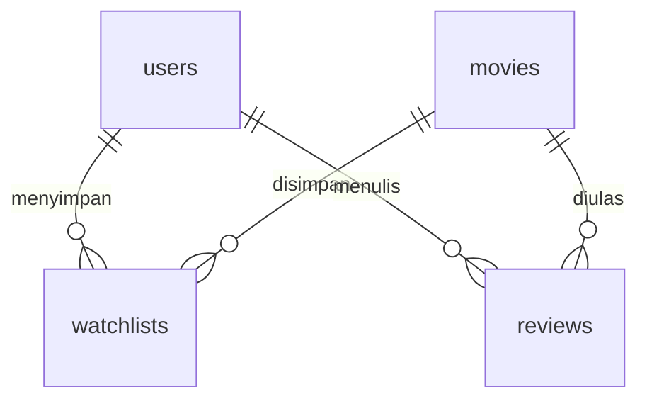

# FilmLog Backend

REST API untuk katalog film FilmLog, dibangun dengan Node.js, Express, dan SQLite. API menyediakan registrasi dan login pengguna, daftar film, pencarian judul atau sutradara, filter genre, pengacakan urutan, dan detail film.

## Prasyarat

- Node.js 24 atau lebih baru beserta npm.

## Instalasi

Jalankan dari folder utama repositori.

```cmd
cd backend
npm ci
```

Untuk konfigurasi pertama di Windows CMD, buat file lingkungan dari contoh yang tersedia.

```cmd
copy .env.example .env
```

Pada macOS atau Linux, gunakan `cp .env.example .env`. Jika `.env` sudah tersedia, sesuaikan nilainya dengan konfigurasi berikut.

## Konfigurasi

| Variabel | Default | Keterangan |
| --- | --- | --- |
| `JWT_SECRET` | Wajib diisi | Kunci rahasia acak untuk tanda tangan dan verifikasi JWT. |
| `PORT` | `8000` | Port HTTP, antara 1 dan 65535. |
| `CORS_ORIGIN` | `http://localhost:3000` | Origin frontend yang diizinkan. Pisahkan beberapa origin dengan koma. |
| `DB_PATH` | `storage/filmlog.sqlite` | Lokasi database, relatif terhadap folder backend atau berupa path absolut. |

File `.env` dan database lokal diabaikan oleh Git.

Buat kunci acak JWT dengan perintah berikut, lalu salin hasilnya ke `JWT_SECRET` di `.env`.

```cmd
node -e "console.log(require('node:crypto').randomBytes(32).toString('hex'))"
```

Kunci harus memiliki minimal 32 byte. Mengganti kunci membuat token lama tidak valid.

## Migrasi dan seeding

Jalankan dari folder `backend`.

```cmd
npm run db:migrate
npm run db:seed
```

Migrasi membuat tabel dan mencatat berkas SQL yang sudah diterapkan dalam `schema_migrations`. Seeder membaca 20 film dari `data/movies.json` di direktori utama repositori.

Kedua perintah aman dijalankan berulang. Migrasi yang sudah diterapkan dilewati, dan seeder melewati ID film yang sudah tersedia. Masing-masing proses menggunakan transaksi untuk menjaga konsistensi perubahan.

## Menjalankan server

Untuk pengembangan dengan pemuatan ulang otomatis ketika kode berubah, jalankan perintah berikut.

```cmd
npm run dev
```

Untuk menjalankan server tanpa pemantauan perubahan, gunakan `npm start`. Server memeriksa dan menerapkan migrasi sebelum membuka port HTTP. Seeding dijalankan melalui perintah terpisah.

Alamat API default adalah `http://localhost:8000/api`. Periksa proses server melalui [health endpoint](http://localhost:8000/api/health).

## API

| Metode | Endpoint | Respons berhasil |
| --- | --- | --- |
| `POST` | `/api/auth/register` | `201` dengan profil pengguna. |
| `POST` | `/api/auth/login` | `200` dengan token JWT dan profil pengguna. |
| `GET` | `/api/health` | `200` dengan status proses HTTP. |
| `GET` | `/api/movies` | `200` dengan array film. |
| `GET` | `/api/movies/:id` | `200` dengan objek film. |

### Autentikasi

`POST /api/auth/register` menerima body berikut dan mengembalikan status `201` dengan objek `user` berisi `id`, `username`, dan `email`.

```json
{
  "username": "alice",
  "email": "alice@example.com",
  "password": "contoh-password-kuat"
}
```

Username wajib diisi dan maksimal 50 karakter. Email dinormalisasi ke huruf kecil dan harus unik. Password minimal 8 karakter dan maksimal 72 byte UTF-8. Spasi dalam password dipertahankan. Karakter Unicode dapat memakai lebih dari satu byte.

`POST /api/auth/login` menerima `email` dan `password`, lalu mengembalikan status `200` dengan format berikut.

```json
{
  "token": "<JWT>",
  "user": {
    "id": 1,
    "username": "alice",
    "email": "alice@example.com"
  }
}
```

Password disimpan sebagai hash bcrypt dengan cost 12 dan salt acak. Respons hanya menyertakan profil publik pengguna. JWT memakai HS256, berlaku satu jam, dan memuat ID pengguna dalam klaim `sub`. Middleware memverifikasi algoritma, tanda tangan, masa berlaku, issuer, audience, serta keberadaan pengguna di database.

Untuk rute yang diproteksi middleware autentikasi, kirim header berikut.

```http
Authorization: Bearer <JWT>
```

### Parameter katalog

| Parameter | Keterangan |
| --- | --- |
| `search` | Pencarian sebagian judul atau nama sutradara, maksimal 200 karakter. |
| `genre` | Filter nama genre, maksimal 50 karakter. |
| `shuffle` | `true` untuk mengacak hasil atau `false` untuk urutan berdasarkan ID. |

Parameter bersifat opsional dan dapat digabungkan. Parameter yang sama dengan beberapa nilai ditolak dengan status `400`. Pencarian tanpa hasil mengembalikan array kosong dengan status `200`.

```http
GET /api/movies?genre=Sci-Fi&search=Inception
GET /api/movies?shuffle=true
GET /api/movies/7
```

Objek film memiliki field `id`, `title`, `year`, `director`, `genres`, `rating`, `duration`, `synopsis`, `poster_url`, dan `cast`. Field `genres` dan `cast` berupa array. Rating katalog memakai skala 0–10.

### Respons error

Error dikembalikan sebagai JSON dengan field `message`.

```json
{
  "message": "Film tidak ditemukan."
}
```

| Status | Kondisi |
| --- | --- |
| `400` | ID atau parameter tidak valid, atau body JSON rusak. |
| `401` | Kredensial atau token tidak valid. |
| `409` | Email sudah terdaftar. |
| `404` | Film atau endpoint tidak ditemukan. |
| `413` | Body request melebihi 16 KB. |
| `500` | Kesalahan server yang tidak terduga. |

Detail error internal dicatat di terminal server. Respons `500` menggunakan pesan umum.

## Database



| Tabel | Fungsi dan constraint |
| --- | --- |
| `users` | Profil dan hash password. Email unik tanpa membedakan huruf besar dan kecil. |
| `movies` | Katalog film. Genre dan pemeran disimpan sebagai array JSON. |
| `watchlists` | Relasi pengguna dan film dengan primary key gabungan `user_id` dan `movie_id`. |
| `reviews` | Catatan tontonan dengan rating pengguna berupa bilangan bulat 1–5 dan ulasan sepanjang 1–2000 karakter. |
| `schema_migrations` | Nama migrasi dan waktu penerapannya. |

Foreign key diaktifkan pada setiap koneksi. Penghapusan pengguna atau film menghapus relasi terkait melalui `ON DELETE CASCADE`. Indeks tersedia untuk relasi film dan riwayat pengguna. Setiap ulasan memiliki ID sendiri untuk mendukung pencatatan tontonan ulang.

## Struktur kode

```text
backend/
├── src/
│   ├── config/env.js
│   ├── database/
│   │   ├── connection.js
│   │   ├── migrate.js
│   │   ├── seed.js
│   │   └── migrations/001_initial_schema.sql
│   ├── routes/
│   │   ├── auth.routes.js
│   │   ├── health.routes.js
│   │   └── movies.routes.js
│   ├── controllers/
│   │   ├── auth.controller.js
│   │   └── movies.controller.js
│   ├── services/
│   │   ├── auth.service.js
│   │   └── movies.service.js
│   ├── validators/
│   │   ├── auth.schemas.js
│   │   └── movies.schemas.js
│   ├── errors/app-error.js
│   ├── middleware/
│   │   ├── authenticate.js
│   │   ├── validate.js
│   │   └── error-handler.js
│   ├── app.js
│   └── server.js
├── tests/auth.test.js
├── .env.example
├── package.json
├── package-lock.json
└── README.md
```

Route memetakan endpoint ke controller. Controller memvalidasi parameter, memanggil service, dan mengirim respons HTTP. Service mengakses database melalui kueri berparameter dan menyiapkan data respons.

`app.js` menyusun middleware dan route. `server.js` menjalankan migrasi, membuka port, dan menutup koneksi database saat server dihentikan.

## Frontend companion

Express menyajikan frontend dari folder `frontend/` pada origin yang sama dengan API. Jalankan `npm run dev` dari folder `backend`, lalu buka [FilmLog](http://localhost:8000/).

API Base URL default mengikuti alamat server dengan akhiran `/api`. Jika sebelumnya sudah menyimpan URL melalui pengaturan frontend, sesuaikan nilainya dengan alamat backend yang sedang berjalan. Panel API Inspector menampilkan hasil request. Dataset fallback tersedia melalui `/data/movies.json`.

## Pengujian

Jalankan `npm test` dari folder `backend`.

Tes integrasi menggunakan HTTP lokal, SQLite dalam memori, dan kunci JWT khusus pengujian. Cakupannya meliputi registrasi, hashing bcrypt, email duplikat termasuk request bersamaan, login, validasi input, JWT kedaluwarsa atau tidak valid, serta pengguna yang sudah dihapus. Route khusus di server pengujian memeriksa middleware autentikasi. Katalog dan health endpoint juga diperiksa untuk memastikan tetap dapat diakses.

## Sumber

Frontend companion dan dataset film berasal dari [movie-watchlist-starter](https://github.com/bimoar07/movie-watchlist-starter).

