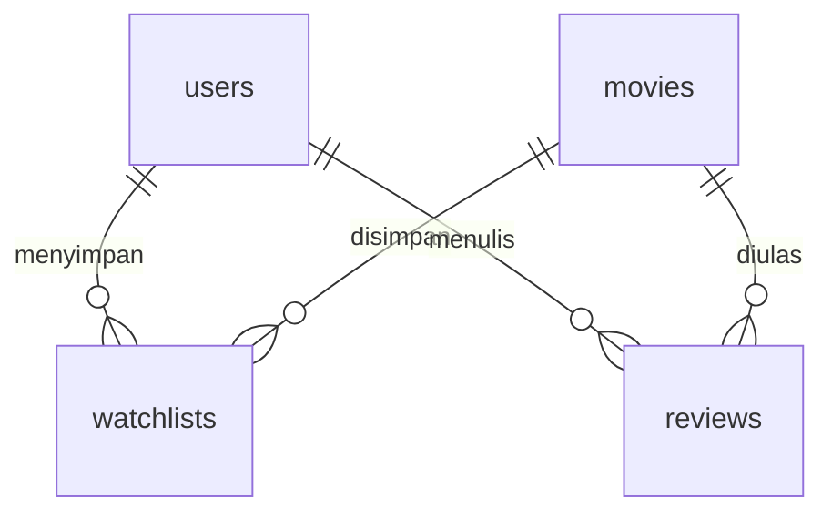

# FilmLog Backend

REST API untuk katalog film FilmLog, dibangun dengan Node.js, Express, dan SQLite. API menyediakan daftar film, pencarian judul atau sutradara, filter genre, pengacakan urutan, dan detail film.

## Prasyarat

- Node.js 24 atau lebih baru beserta npm.
- Python 3 jika menjalankan frontend melalui server statis pada contoh di bawah.

## Instalasi

Jalankan dari folder utama repositori.

```cmd
cd backend
npm ci
```

Untuk konfigurasi pertama di Windows CMD, buat file lingkungan dari contoh yang tersedia.

```cmd
copy .env.example .env
```

Pada macOS atau Linux, gunakan `cp .env.example .env`. Jika `.env` sudah tersedia, sesuaikan nilainya dengan konfigurasi berikut.

## Konfigurasi

| Variabel | Default | Keterangan |
| --- | --- | --- |
| `PORT` | `8000` | Port HTTP, antara 1 dan 65535. |
| `CORS_ORIGIN` | `http://localhost:3000` | Origin frontend yang diizinkan. Pisahkan beberapa origin dengan koma. |
| `DB_PATH` | `storage/filmlog.sqlite` | Lokasi database, relatif terhadap folder backend atau berupa path absolut. |

File `.env` dan database lokal diabaikan oleh Git.

## Migrasi dan seeding

Jalankan dari folder `backend`.

```cmd
npm run db:migrate
npm run db:seed
```

Migrasi membuat tabel dan mencatat berkas SQL yang sudah diterapkan dalam `schema_migrations`. Seeder membaca 20 film dari `data/movies.json` di direktori utama repositori.

Kedua perintah aman dijalankan berulang. Migrasi yang sudah diterapkan dilewati, dan seeder melewati ID film yang sudah tersedia. Masing-masing proses menggunakan transaksi untuk menjaga konsistensi perubahan.

## Menjalankan server

Untuk pengembangan dengan pemuatan ulang otomatis ketika kode berubah, jalankan perintah berikut.

```cmd
npm run dev
```

Untuk menjalankan server tanpa pemantauan perubahan, gunakan `npm start`. Server memeriksa dan menerapkan migrasi sebelum membuka port HTTP. Seeding dijalankan melalui perintah terpisah.

Alamat API default adalah `http://localhost:8000/api`. Periksa proses server melalui [health endpoint](http://localhost:8000/api/health).

## API

| Metode | Endpoint | Respons berhasil |
| --- | --- | --- |
| `GET` | `/api/health` | `200` dengan status proses HTTP. |
| `GET` | `/api/movies` | `200` dengan array film. |
| `GET` | `/api/movies/:id` | `200` dengan objek film. |

### Parameter katalog

| Parameter | Keterangan |
| --- | --- |
| `search` | Pencarian sebagian judul atau nama sutradara, maksimal 200 karakter. |
| `genre` | Filter nama genre, maksimal 50 karakter. |
| `shuffle` | `true` untuk mengacak hasil atau `false` untuk urutan berdasarkan ID. |

Parameter bersifat opsional dan dapat digabungkan. Parameter yang sama dengan beberapa nilai ditolak dengan status `400`. Pencarian tanpa hasil mengembalikan array kosong dengan status `200`.

```http
GET /api/movies?genre=Sci-Fi&search=Inception
GET /api/movies?shuffle=true
GET /api/movies/7
```

Objek film memiliki field `id`, `title`, `year`, `director`, `genres`, `rating`, `duration`, `synopsis`, `poster_url`, dan `cast`. Field `genres` dan `cast` berupa array. Rating katalog memakai skala 0–10.

### Respons error

Error dikembalikan sebagai JSON dengan field `message`.

```json
{
  "message": "Film tidak ditemukan."
}
```

| Status | Kondisi |
| --- | --- |
| `400` | ID atau parameter tidak valid, atau body JSON rusak. |
| `404` | Film atau endpoint tidak ditemukan. |
| `413` | Body request melebihi 16 KB. |
| `500` | Kesalahan server yang tidak terduga. |

Detail error internal dicatat di terminal server. Respons `500` menggunakan pesan umum.

## Database



| Tabel | Fungsi dan constraint |
| --- | --- |
| `users` | Profil dan hash password. Email unik tanpa membedakan huruf besar dan kecil. |
| `movies` | Katalog film. Genre dan pemeran disimpan sebagai array JSON. |
| `watchlists` | Relasi pengguna dan film dengan primary key gabungan `user_id` dan `movie_id`. |
| `reviews` | Catatan tontonan dengan rating pengguna berupa bilangan bulat 1–5 dan ulasan sepanjang 1–2000 karakter. |
| `schema_migrations` | Nama migrasi dan waktu penerapannya. |

Foreign key diaktifkan pada setiap koneksi. Penghapusan pengguna atau film menghapus relasi terkait melalui `ON DELETE CASCADE`. Indeks tersedia untuk relasi film dan riwayat pengguna. Setiap ulasan memiliki ID sendiri untuk mendukung pencatatan tontonan ulang.

## Struktur kode

```text
backend/
├── src/
│   ├── config/env.js
│   ├── database/
│   │   ├── connection.js
│   │   ├── migrate.js
│   │   ├── seed.js
│   │   └── migrations/001_initial_schema.sql
│   ├── routes/
│   │   ├── health.routes.js
│   │   └── movies.routes.js
│   ├── controllers/movies.controller.js
│   ├── services/movies.service.js
│   ├── validators/movies.schemas.js
│   ├── errors/app-error.js
│   ├── middleware/error-handler.js
│   ├── app.js
│   └── server.js
├── .env.example
├── package.json
├── package-lock.json
└── README.md
```

Route memetakan endpoint ke controller. Controller memvalidasi parameter, memanggil service, dan mengirim respons HTTP. Service mengakses database melalui kueri berparameter dan menyiapkan data respons.

`app.js` menyusun middleware dan route. `server.js` menjalankan migrasi, membuka port, dan menutup koneksi database saat server dihentikan.

## Frontend companion

Jalankan backend, lalu buka terminal lain di folder utama repositori.

```cmd
python -m http.server 3000
```

Buka [frontend FilmLog](http://localhost:3000/frontend/) dan atur API Base URL menjadi `http://localhost:8000/api`. Panel API Inspector menampilkan hasil permintaan ke backend. Katalog juga dapat tampil dari dataset lokal ketika koneksi API gagal.

## Sumber

Frontend companion dan dataset film berasal dari [movie-watchlist-starter](https://github.com/bimoar07/movie-watchlist-starter).

